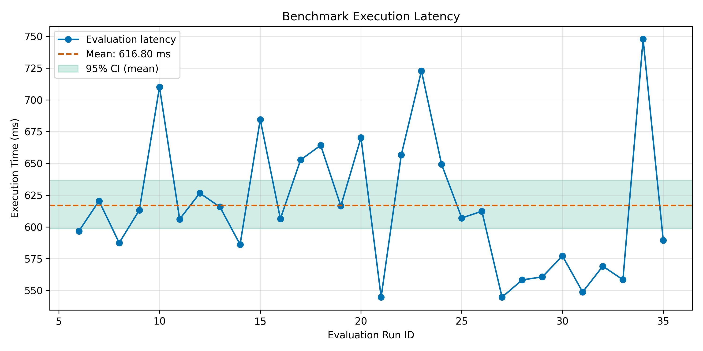
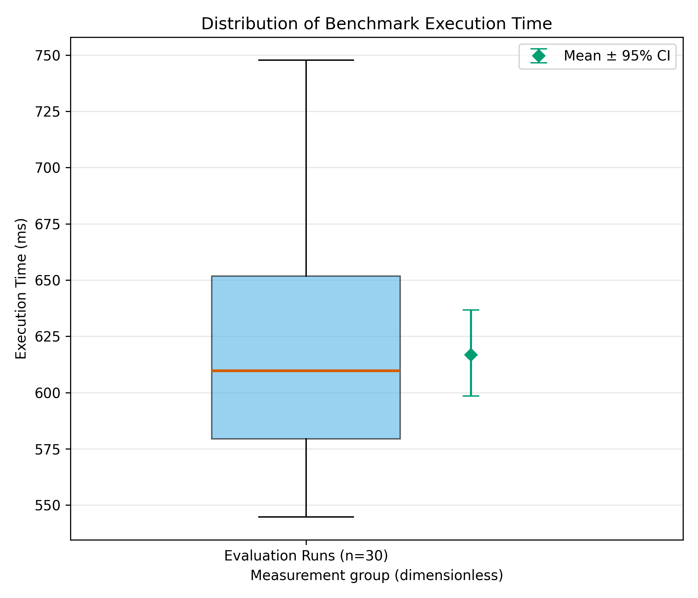
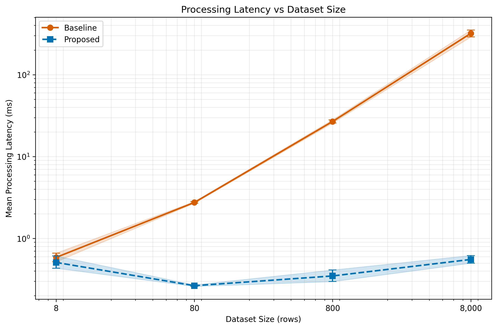

# Impact of Heating Season and Meteorological Conditions on Air Pollution in Almaty

Task 3 compares two implementations of the seasonal PM2.5 mean difference. At 8,000 rows the row loop averaged 320.405 ms and the Pandas aggregation averaged 0.555 ms. Both returned the same result on the repeated sample.

[Read the two-page report](reports/task3_report.pdf) · [Inspect the executed notebook](notebooks/01_data_analysis.ipynb) · [View the mathematical model](docs/domain_model.md)

## Project Information
* **Author:** Abildayev Dinmukhammed
* **Course / Context:** Applied Data Science Research
* **Research Type:** Quantitative research proposal with a pipeline performance experiment

## Research Question
How do heating season emissions and meteorological calm (wind speed $< 1.0\text{ m/s}$) synergistically impact fine particulate matter concentrations ($\text{PM}_{2.5}$, $\text{PM}_{10}$) and $\text{NO}_2$ in the mountain basin of Almaty?

## Repository Structure

```text
almaty-air-pollution-analysis/
├── configs/config.yaml
├── data/sample/almaty_air_sample.csv
├── data/raw/                       # Small original JSONL measurement logs
├── data/processed/                 # Recomputed CSV summaries
├── docs/domain_model.md            # Loss, metrics, notation and limitations
├── notebooks/01_data_analysis.ipynb # Executed analysis with visible outputs
├── reports/figures/                # Vector PDF and 300 DPI PNG
├── src/                            # Measurement, statistics and plotting modules
├── tests/test_analysis.py
├── requirements.txt
├── Dockerfile
└── README.md
```

## Planned Environmental Metrics and Implemented Pipeline Metrics

| Metric Category | Metric Name | Definition / Target | Role |
| :--- | :--- | :--- | :--- |
| **Primary** | Mean Difference ($\Delta \bar{X}$) | $\mu_{\text{winter}} - \mu_{\text{summer}}$ ($\text{PM}_{2.5}$) | Assess seasonal shift |
| **Primary** | Interaction Coeff ($\beta_3$) | Synergy coefficient ($p < 0.05$) | Test $H_{1,2}$ synergy |
| **Guardrail** | Missing Data Rate (MDR) | $\le 15\%$ missing entries per sensor | Data integrity safeguard |
| **Guardrail** | Calibration $R^2$ | $R^2_{\text{calib}} \ge 0.75$ with reference stations | Sensor drift control |
| **Pipeline** | Processing Latency | Time to run benchmark pipeline (ms) | Speed & efficiency |

The interaction model and calibration R2 are planned, not measured in Task 3.
No paired reference-station data are present. PM10 and NO2 are sample columns;
the implemented seasonal contrast concerns PM2.5 only. The 8-row contrast is
75.9 ug/m3 and the PM2.5 missing-data rate is 0%; neither establishes population effects.

---

## System Requirements

- Python 3.12 (tested with 3.12.3)
- pip (Python package manager)
- Git (for version control)
- Windows, Linux, or macOS
- Dependencies listed in `requirements.txt`
- Docker (optional, for containerized execution)

## Quickstart Guide

Run the pipeline benchmark using one of the following methods:

### Option 1: Local Python Environment
```bash
# 1. Install pinned dependencies
pip install -r requirements.txt

# 2. Run the benchmark script on the sample dataset
python src/benchmark.py
```

### Option 2: Docker Environment
```bash
# 1. Build Docker image
docker build -t almaty-air-benchmark .

# 2. Run benchmark inside container
docker run --rm almaty-air-benchmark
```

## Reproduce Task 3 from the saved logs

Use Python 3.12 and run these commands from the repository root. In PowerShell:

```powershell
python -m venv .venv
.\.venv\Scripts\python.exe -m pip install -r requirements.txt
.\.venv\Scripts\python.exe -m jupyter nbconvert --to notebook --execute --inplace notebooks/01_data_analysis.ipynb
.\.venv\Scripts\python.exe -m unittest discover -s tests -v
```

Select this same environment as the notebook kernel in VS Code. Package installation
belongs in the terminal. Alternatively, activate your environment and run modules:

```bash
python src/process_data.py
python src/process_comparison.py
python src/visualize.py
```

The notebook recomputes both CSV summaries directly from validated JSONL files,
checks method equivalence, displays all three plots, and exports every plot.
Bootstrap seed is 42 with 10,000 resamples. Small logs are intentionally committed.

### Collect new measurements

```bash
python src/run_experiments.py
python src/compare_methods.py
```

These commands overwrite the corresponding raw measurement files. They are optional:
the submitted results use the original logs dated 28 October 2026 (UTC). A new run
will have different timings; rerun the analysis and update the README tables if
you replace those logs. Original machine metadata was not captured. Re-executed
notebook outputs show the analysis environment, not the original measurement environment.

The subprocess benchmark includes startup, imports, configuration, CSV I/O and
logging. The method benchmark times only the function on an already-loaded frame.
These scopes must be interpreted separately. Every subprocess is newly started;
excluding the first five attempts does not eliminate its interpreter/import cost.

## Results & Discussion

### Benchmark Performance Results

The benchmark was executed 35 times using the same
8-row environmental sample dataset.

The first 5 runs were used for warm-up and excluded
from statistical analysis.

The remaining 30 evaluation runs were analyzed.

| Metric | Result |
|---|---:|
| Evaluation Runs | 30 |
| Successful Runs | 30 |
| Error Rate | 0.00% |
| Mean Latency | 616.80 ms |
| Median Latency | 609.67 ms |
| Standard Deviation | 53.49 ms |
| P95 Latency | 717.09 ms |
| P99 Latency | 740.53 ms |
| 95% Bootstrap CI (Mean) | 598.56–636.77 ms |

### Scientific Visualizations

**Figure 1 — Benchmark Execution Latency**



**Figure 2 — Execution Time Distribution**



### Discussion

The benchmark achieved a mean execution time of
616.80 ms with a standard deviation of 53.49 ms.

The 95% bootstrap confidence interval for mean
execution time was 598.56–636.77 ms.

All 30 evaluation runs completed successfully,
resulting in an observed error rate of 0%.

These results describe the total execution time
of the Python benchmark process, including
interpreter startup and library imports.

The environmental sample contains only 8 observations.
Therefore, these benchmark results do not establish
statistically reliable conclusions about air pollution
patterns in Almaty.


### Baseline vs Proposed Method

Two implementations of the same PM2.5 seasonal mean
difference calculation were compared:

- **Baseline:** Row-by-row processing using Python loops.
- **Proposed Method:** Vectorized processing using Pandas.

Both methods returned equivalent numerical results.

The experiment used four dataset sizes created by
repeating the original 8 sample observations.
These synthetic workloads were used only for
performance testing, not environmental analysis.

Each method was tested with 5 warm-up runs and
30 evaluation runs per dataset size.

#### Performance Comparison

Mean processing latency is reported as Mean ± SD.

| Dataset Size | Baseline (Mean ± SD), ms | Proposed (Mean ± SD), ms | Speedup |
|---|---:|---:|---:|
| 8 rows | 0.587 ± 0.206 | 0.510 ± 0.252 | 1.15x |
| 80 rows | 2.754 ± 0.186 | 0.265 ± 0.016 | 10.39x |
| 800 rows | 26.862 ± 3.531 | 0.349 ± 0.164 | 77.05x |
| 8,000 rows | 320.405 ± 90.569 | 0.555 ± 0.172 | 577.78x |


#### Processing Latency vs Dataset Size



The plot uses logarithmic axes and includes
95% bootstrap confidence intervals.

#### Discussion

The Proposed Method showed lower observed mean processing
latency at all four tested dataset sizes. At 8 rows, the two 95% mean
confidence intervals overlap, so a clear small-load advantage is not established.

The largest observed speedup was approximately
578x at 8,000 rows.

This result reflects the performance difference
between the tested implementations and does not
imply that Pandas is universally faster.

The benchmark uses repeated sample rows, and
therefore does not represent additional independent
air pollution observations.

The measurements were also performed sequentially
on one computer, so hardware conditions and
execution order may influence the results. The original measurement loop ran
each method in a separate block. Future experiments should randomize or alternate
order and record hardware, OS, dependency versions, and background load.

Latency uses successful evaluation attempts only. Error rate includes all
evaluation attempts: 0/30 for the subprocess experiment and 0/30 for each
method/load group. Zero observed failures does not imply a zero population failure rate.
The bootstrap CI estimates uncertainty of the mean under approximate run independence.
P95 and P99 use linear interpolation; with n=30 the p99 is unstable.
The boxplot whiskers use the 1.5 IQR rule; SD and mean CI describe different quantities.


### Domain Model

The mathematical formalization of the research
hypotheses, logistic regression model, loss function,
and evaluation metrics is available here:

[Domain Model](docs/domain_model.md)


## License
Distributed under the MIT License.


## Citation

If you use this project in your research or academic work,
please cite the GitHub repository:

**Project:** Almaty Air Pollution Analysis

**Repository:** https://github.com/aninakit/almaty-air-pollution-analysis

**Citation format:**

Almaty Air Pollution Analysis. (2026).
GitHub repository.
https://github.com/aninakit/almaty-air-pollution-analysis
